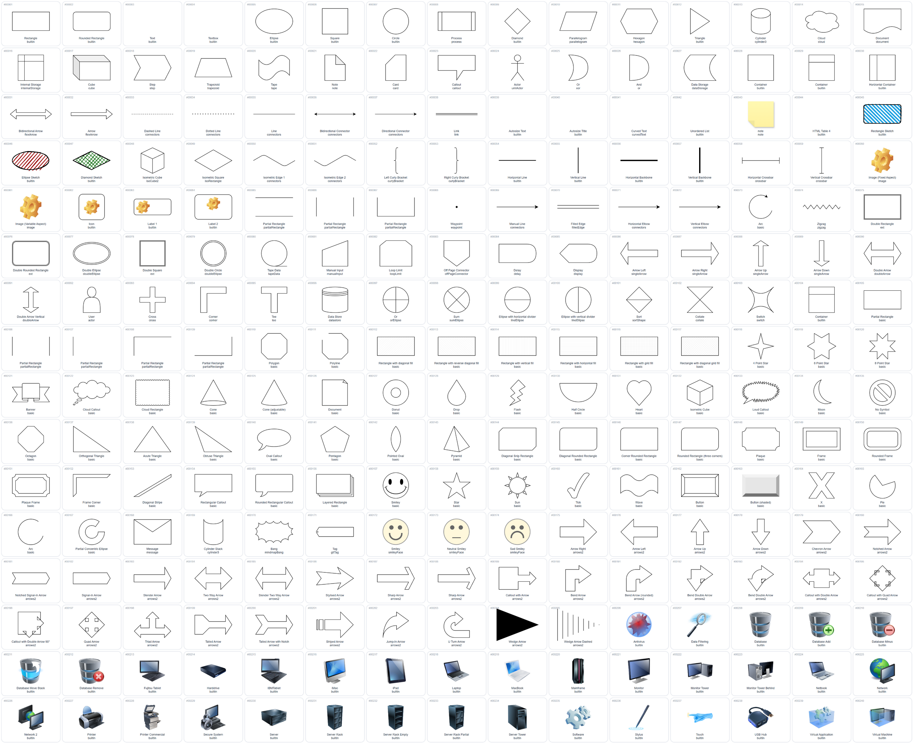

# Draw.io Ontology — See the shapes before you draw

[中文说明](README.zh-CN.md) · [Browse the gallery](https://wjh19990923.github.io/drawio-ontology/) · [Agent entry point](AGENTS.md)

**“What shapes and icons can I actually use in Draw.io?”**

This repository answers that question with a visual catalog and a searchable, agent-readable index. Browse the pictures, find a shape ID, then retrieve its exact Draw.io style or copy the editable shape into your diagram.

An independent community catalog built using [drawio-skill](https://github.com/Agents365-ai/drawio-skill) and [Draw.io Desktop](https://github.com/jgraph/drawio-desktop). It is not an official Draw.io product.

## What's inside

| Collection | Snapshot count | Purpose |
|---|---:|---|
| Official palette entries | 10,446 | Exact styles, dimensions and search tags |
| Contact sheets | 44 | Scan many shapes at once |
| Individual PNG previews | 10,446 | Browse individual shapes by category |
| Derived library / style groups | 135 | Navigate the collection; not 135 official palette names |
| External brand SVGs | 328 | Local AI, LLM and data-system logos |
| Skill scripts | 38 | Discover diagram generation and conversion workflows |
| Diagram-type presets | 11 | Choose a suitable diagram structure |

The contact sheets and individual PNGs show **the same collection** in two formats. The SVG brand collection is separate. This is a snapshot built in August 2026 with Draw.io Desktop 30.0.4 and drawio-skill 2.1.0, not a claim to include every shape in all current Draw.io releases. Each external brand has a selected variant, not every available variant.

## A visual sample



[View brand-logo contact sheet](01_官方Shapes_PNG/png/shapes_044_10321-10446.png)

## Browse and reuse

1. Open the [online gallery](https://wjh19990923.github.io/drawio-ontology/), or download this repository using **Code → Download ZIP**, extract it, and open `index.html`. GitHub file pages display HTML source; the gallery or local file renders it.
2. Choose **contact sheets** for an overview or **individual PNGs** for category browsing. Note the shape ID.
3. Query the index for that ID/name. Open its `editable_source` `.drawio` file in Draw.io and copy the numbered shape, or use its `style` with the supplied dimensions.
4. Local brand SVGs can be dragged into Draw.io.

PNG files are small raster previews. Use the editable source for vector shapes and the SVG files for brand icons. The full download is approximately 203 MiB before Git compression.

## For agents

Start with [AGENTS.md](AGENTS.md), then [agent-manifest.json](agent-manifest.json). Read intent routes and query only the relevant records; do not put the complete shape index into the context window.

With Python 3 installed, run from the repository root:

```sh
python ontology/query_ontology.py "aws lambda" --kind shape --limit 5
python ontology/query_ontology.py "OpenAI" --kind icon
python ontology/query_ontology.py "LPIPS" --kind diagram
python ontology/query_ontology.py "Terraform" --kind capability
python ontology/validate_ontology.py
```

The query tool uses only the Python standard library and works offline. Full results include dimensions, asset paths and workflow details; `--compact` returns a smaller subset. Diagram generation uses additional dependencies documented in the bundled skill. The search is keyword-based, not an embedding search or reasoning engine.

## Directory map

| Path | Contents |
|---|---|
| `01_官方Shapes_PNG/` | Contact sheets, individual previews and editable sources |
| `02_完整Shape索引/` | Detailed CSV/JSON index |
| `03_AI与数据图标_SVG/` | Local external SVG icons and provenance manifest |
| `04_skill完整副本/` | Bundled drawio-skill snapshot; read its instructions before execution |
| `05_Drawio内置图片资源/` | Resource files extracted from Draw.io, including their notice |
| `ontology/` | JSONL discovery records, JSON-LD summary and query/validation tools |

The ontology is a lightweight discovery model, not a complete OWL ontology. The JSON-LD file summarizes capabilities, diagram types, libraries and icons; individual shapes live in JSONL. Domain categories are heuristic and may need refinement.

## Limitations and contributions

Previews were generated in batches and spot-checked, not manually verified one by one. Cropping, complex styles or text-dependent shapes may produce incomplete previews; empty Text entries are expected. If a preview looks wrong, inspect the editable source. Some original styles contain relative image paths; the editable contact sheets embed local resources for portability.

Report a problem with the shape ID, expected appearance and Draw.io version. Useful contributions include better search aliases, corrected previews, more accurate categories and reproducible catalog builders. Historical rendering scripts are not included in this snapshot; the sources, indexes and preview outputs are included.

## Attribution and licensing

Our original catalog documentation and query/validation code are MIT licensed. **That does not relicense the third-party shapes, logos, data or bundled skill.** See [LICENSE](LICENSE) and [THIRD_PARTY_NOTICES.md](THIRD_PARTY_NOTICES.md).

The bundled Draw.io asset notice restricts use of icon/stencil assets and derivatives in the Atlassian ecosystem without written permission, with an exception for end-user diagram output. We retain that notice in full. Brand logos remain the trademarks of their owners. Check the applicable upstream terms before redistributing assets in other products.
